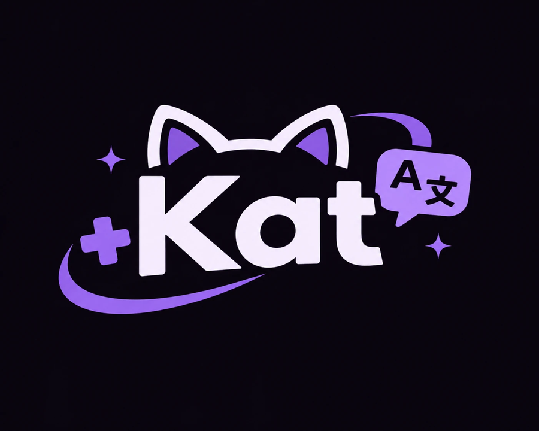

# Kat — голосовой переводчик для игр

Переводит голос в играх и Discord прямо поверх экрана. Работает офлайн, на вашем компьютере.

| Клавиша | Что делает |
|---|---|
| **F9** (держать) | Говоришь по-русски — внизу экрана перевод на английский. Он же копируется в буфер, можно вставить в чат через Ctrl+V. |
| **F10** | Переводит на русский, что собеседники сказали за последние ~10 секунд. |
| **F11** | Живой перевод вкл/выкл: Kat сам переводит английскую речь собеседников прямо по ходу фразы, как субтитры. Русскую речь пропускает. |
| **Ctrl+Shift+F9** | Выход. |

Клавиши, микрофон, устройство звука и вид текста меняются в окне «Настройки» (иконка Kat в трее, возле часов).

### Другие языки

Кроме английского, Kat может переводить ещё один язык собеседников на выбор —
немецкий, испанский, французский, итальянский, португальский, польский, украинский,
турецкий, японский, китайский, корейский, арабский и другие (всего 28).
Выберите его в «Настройках» → «Языки»: модели (~700 МБ) скачаются один раз, только для
выбранного языка. Там же можно выбрать, на какой язык переводить свою речь (F9).

## Установка

1. Скачайте **[KatSetup.exe](https://github.com/L0lik909/voice-translator/releases/latest)**
   из последнего релиза (раздел **Assets**) и запустите.
2. Если Windows покажет «Система Windows защитила ваш компьютер» — нажмите
   **«Подробнее» → «Выполнить в любом случае»**. Это обычное предупреждение для программ
   без платной цифровой подписи.
3. Нажмите «Далее» → «Установить». Права администратора и Python не нужны.
4. При первом запуске Kat скачает модели (~2 ГБ), а если у вас видеокарта NVIDIA — ещё и
   библиотеки для неё (~2 ГБ). Ход загрузки виден внизу экрана. Дальше интернет не нужен.

Что нужно: Windows 10 или 11 (64-бит), ~5 ГБ на диске. Видеокарта NVIDIA — желательно:
без неё Kat работает на процессоре, медленнее и с моделью попроще.

## Обновление

Kat сам проверяет обновления при запуске. Когда выйдет новая версия, в меню иконки в трее
появится **«⬇ Обновить до …»** — нажмите, и Kat скачает новую версию, установит её и
перезапустится сам. Настройки, модели и ваши слова в `words.txt` сохранятся.

## Удаление

«Параметры Windows» → «Приложения» → **Kat — голосовой переводчик** → «Удалить».
Удаляется всё, включая скачанные модели.

## Запуск из исходников (для разработчиков)

Нужен [Python](https://www.python.org/downloads/) 3.10+ с галочкой «Add python.exe to PATH».
Скачайте **Source code (zip)** из релиза, распакуйте и запустите `start.bat` — он поставит
компоненты и создаст ярлыки. Чтобы обновиться — распакуйте новую версию поверх и снова
запустите `start.bat`.

Установщик собирается командой `installeruild.bat` (нужны Python 3.10 и
[Inno Setup](https://jrsoftware.org/isdl.php)) — результат в `dist\KatSetup-<версия>.exe`.

## Если клавиши не срабатывают в игре

Если игра запущена от администратора (например Genshin Impact) и клавиши в ней не срабатывают —
в настройках включите «Запускать от имени администратора».

## Файлы

- `translator.py` — сама программа (в установленной версии — `Kat.exe`).
- `words.txt` — подсказки распознаванию: имена героев, сленг.
- `glossary.txt` — словарь для перевода: короткие фразы и сленг.
- `settings.ini` — настройки (создаётся при первом запуске).
- `log.txt` — что происходит в программе; смотрите его, если что-то не работает.

Что поменялось в каждой версии — в [CHANGELOG.md](CHANGELOG.md) и в описании релизов.

Модели: [faster-whisper](https://github.com/SYSTRAN/faster-whisper) large-v3-turbo для распознавания,
[quickmt](https://huggingface.co/quickmt) для перевода.
